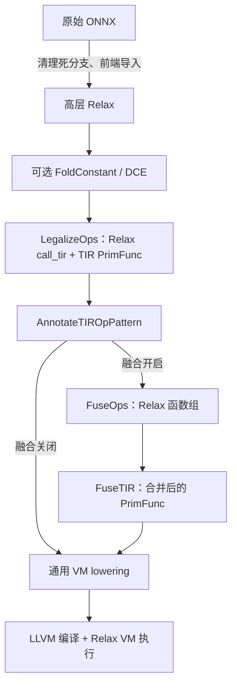

# TVM 实践报告：从 ONNX、Relax 到 TIR

实验日期：2026-11-06。本文记录重构后依次执行主实验与调优脚本得到的一组结果，数据来自 [results.json](outputs/results.json) 和 [tune_results.json](outputs/tune_results.json)。通用概念见 [TVM 入门](TVM入门.md)。

## 1. 实验目标与环境

本次实践围绕自定义 ONNX 模型完成四项任务：导入并阅读 Relax；观察常量折叠、DCE 与融合；对照融合开关检查正确性和耗时；通过小型矩阵乘理解底层 auto-tune。

| 项目 | 配置 |
| --- | --- |
| 系统与 CPU | WSL2 / Linux x86_64，Intel Core i9-14900HX |
| Python 环境 | `cuda-dev`，Python 3.12 |
| TVM | `0.25.0.post1`，`apache-tvm-ffi==0.1.12` |
| 数值与模型依赖 | NumPy `2.5.2`、ONNX `1.17.0`、ONNX Runtime `1.31.1` |
| 编译目标 | LLVM，`mcpu=alderlake`，`num-cores=1` |
| 执行条件 | 数值库单线程，绑定进程可用集合中的第一个逻辑 CPU |
| 主模型随机性 | 权重种子 0，测试输入种子 0～4 |
| 调优预算 | 128×128 FP32 矩阵乘，16 个候选，搜索种子 0 |

环境名虽然带 `cuda`，本实验实际没有使用 GPU。代码按当前版本使用 `tvm.tirx` 与 `tvm.s_tir.meta_schedule`，报告沿用任务中的“TIR”名称。

复现命令如下；新机器需先安装 [依赖](requirements.txt)，并根据 CPU 修改公共模块中的 target。

```bash
conda run --no-capture-output -n cuda-dev python -m experiments.lab
conda run --no-capture-output -n cuda-dev python -m experiments.tune
```

代码按职责拆分：[models.py](tvm_lab/models.py) 定义模型与教学 IR，[common.py](tvm_lab/common.py) 设置运行环境、校验和计时，[lab.py](experiments/lab.py) 组织图优化实验，[tune.py](experiments/tune.py) 组织调优。两个入口都先导入公共模块，调优不再通过导入整个主实验来复用工具。

## 2. ONNX 模型与导入前处理

### 2.1 模型结构

直接使用 ONNX helper 构图，避免其他框架的导出过程提前简化想观察的节点。原模型保存在 [model.onnx](outputs/model.onnx)，采用 opset 17、ONNX IR version 9。

下图为**结构示意**，不是某种 TVM IR 的原文：

```text
x → Conv → Cast(fp16) → Cast(fp32) → Reshape → Reshape → Add(bias) → GELU 拆解链 → output
      └→ Dropout(training=False) → unused_dropout（无人使用）
常量 bias_a + 常量 bias_b ────────────────────────────────┘
```

| 节点 | 形状、类型与含义 |
| --- | --- |
| 输入 `x` | `[1,3,16,16]`，FP32，NCHW |
| Conv | 权重 `[8,3,3,3]`，3×3 卷积、padding=1，输出 `[1,8,16,16]` |
| 两个 Cast | 同一形状，FP32 → FP16 → FP32，保留中间舍入 |
| 两个 Reshape | `[1,8,16,16]` → `[1,8,256]` → `[1,8,16,16]` |
| bias | 两个 `[1,8,1,1]` 常量相加，按通道广播到空间维度 |
| GELU | `0.5*z*(1+erf(z/sqrt(2)))`，拆为 Div、Erf、Add、Mul、Mul |
| 输出 | `[1,8,16,16]`，FP32 |

ONNX 中的 bias_add 语义由广播 `Add` 实现。模型共有 13 个节点，其中 Dropout 是不通向图输出的旁支。

### 2.2 为什么先删除 Dropout

本机版本的 ONNX 前端不支持这个 Dropout 节点，即使结果无人使用，直接导入也会报告不支持。因此 `remove_dead_branch()` 从图输出反向追踪依赖，在副本中删除不可达节点及无用 initializer，得到 12 个节点的待导入图；磁盘保留原始模型。

这个函数只面向本例拓扑有序、没有控制流子图的纯计算图，不是通用 ONNX 优化器。七组输入上，原模型和清理后的模型均使用关闭图优化的 ORT 执行，输出按零容差比较，全部通过。

这一步是 **ONNX 预处理**，不能作为后面 Relax DCE 删除 Dropout 的证据。同样，两个 bias 常量的加法在前端导入时已经折叠，后续 FoldConstant 不能重复领取这项效果。

## 3. 逐阶段阅读真实 IR

完整阶段文本见 [ir.txt](outputs/ir.txt)。以下 Python 代码块均从本次产物摘录，只去掉公共缩进并按说明删节；不是独立可运行文件。`metadata["relax.expr.Constant"]` 表示模块中的常量数据，索引 0、1 在此处分别对应卷积权重和合并后的 bias。文本导出省略了常量数组，不是自包含的模型序列化文件。



### 3.1 导入后的高层 Relax

以下为 `main` 的数据流主体，省略模块与函数声明：

```python
with R.dataflow():
    lv: R.Tensor((1, 8, 16, 16), dtype="float32") = R.nn.conv2d(x, metadata["relax.expr.Constant"][0], strides=[1, 1], padding=[1, 1, 1, 1], dilation=[1, 1], groups=1, data_layout="NCHW", kernel_layout="OIHW", out_layout="NCHW", out_dtype="void")
    lv1: R.Tensor((1, 8, 16, 16), dtype="float16") = R.astype(lv, dtype="float16")
    lv2: R.Tensor((1, 8, 16, 16), dtype="float32") = R.astype(lv1, dtype="float32")
    lv3: R.Tensor((1, 8, 256), dtype="float32") = R.reshape(lv2, R.shape([1, 8, 256]))
    lv4: R.Tensor((1, 8, 16, 16), dtype="float32") = R.reshape(lv3, R.shape([1, 8, 16, 16]))
    lv5: R.Tensor((1, 8, 16, 16), dtype="float32") = R.add(lv4, metadata["relax.expr.Constant"][1])
    lv6: R.Tensor((1, 8, 16, 16), dtype="float32") = R.divide(lv5, R.const(1.4142135381698608, "float32"))
    lv7: R.Tensor((1, 8, 16, 16), dtype="float32") = R.erf(lv6)
    lv8: R.Tensor((1, 8, 16, 16), dtype="float32") = R.add(lv7, R.const(1.0, "float32"))
    lv9: R.Tensor((1, 8, 16, 16), dtype="float32") = R.multiply(lv5, lv8)
    gv: R.Tensor((1, 8, 16, 16), dtype="float32") = R.multiply(lv9, R.const(0.5, "float32"))
    R.output(gv)
```

可以直接沿 `lv → lv1 → ... → gv` 追踪计算。这里的 `R.nn.conv2d` 仍是高层算子；两个 `R.astype` 清楚保留 FP16 中间结果；两个 `R.reshape` 保留形状变化；末尾仍是 GELU 的五步拆解计算，没有假称已识别成单个 GELU 算子。

### 3.2 主模型 FoldConstant / DCE：观察到没有变化

本次分别对同一份导入 IR 执行两个 pass；检查结果是前后结构相等。完整快照分别位于 `主模型版本：fold / FoldConstant` 和 `主模型版本：dce / DeadCodeElimination` 标题下。

下面这一行在导入后、FoldConstant 后和 DCE 后均保持相同：

```python
lv5: R.Tensor((1, 8, 16, 16), dtype="float32") = R.add(lv4, metadata["relax.expr.Constant"][1])
```

| 比较 | 观察结果 | 原因 |
| --- | --- | --- |
| 导入 → FoldConstant | bias 已是常量，依赖输入的 `R.add` 保留 | 原 ONNX 的常量加法已被前端求值 |
| 导入 → DCE | 主计算链保留，未发现新的死分支 | Dropout 在导入前已经清理 |

因此再用两个很小的可控表达式观察真正的 Relax pass 效果。

### 3.3 独立示例：常量折叠与死代码消除

原始 `PassDemo` 的数据流区域：

```python
with R.dataflow():
    bias: R.Tensor((), dtype="float32") = R.add(R.const(0.125, "float32"), R.const(0.25, "float32"))
    unused: R.Tensor((2, 3), dtype="float32") = R.multiply(x, R.const(7.0, "float32"))
    result: R.Tensor((2, 3), dtype="float32") = R.add(x, bias)
    R.output(result)
```

单独执行 `FoldConstant` 后：

```python
with R.dataflow():
    result: R.Tensor((2, 3), dtype="float32") = R.add(x, R.const(0.375, "float32"))
    R.output(result)
```

`0.125 + 0.25` 变成 `0.375`，依赖输入的加法仍存在。还应忠实记录一个细节：这个版本的实际结果中，无用乘法也被清理了，不能把 FoldConstant 的输出误画成仍然含有 `unused`。

单独对**原始**示例执行 DCE 后：

```python
with R.dataflow():
    bias: R.Tensor((), dtype="float32") = R.add(R.const(0.125, "float32"), R.const(0.25, "float32"))
    result: R.Tensor((2, 3), dtype="float32") = R.add(x, bias)
    R.output(result)
```

这次无用乘法消失，而常量加法仍保留，展示了独立 DCE 的作用。两个优化版本不是先折叠再 DCE 的串行结果。原始、折叠、DCE 三种版本都编译执行，各使用五组随机输入与 NumPy 的 `x + 0.375` 零容差比较，全部通过。

### 3.4 LegalizeOps：Relax 调用底层 TIR

下面是 LegalizeOps 后 `main` 的完整数据流区域：

```python
with R.dataflow():
    lv = R.call_tir(cls.conv2d, (x, metadata["relax.expr.Constant"][0]), out_sinfo=R.Tensor((1, 8, 16, 16), dtype="float32"))
    lv1 = R.call_tir(cls.cast, (lv,), out_sinfo=R.Tensor((1, 8, 16, 16), dtype="float16"))
    lv2 = R.call_tir(cls.cast1, (lv1,), out_sinfo=R.Tensor((1, 8, 16, 16), dtype="float32"))
    lv3 = R.call_tir(cls.reshape, (lv2,), out_sinfo=R.Tensor((1, 8, 256), dtype="float32"))
    lv4 = R.call_tir(cls.reshape1, (lv3,), out_sinfo=R.Tensor((1, 8, 16, 16), dtype="float32"))
    lv5 = R.call_tir(cls.add, (lv4, metadata["relax.expr.Constant"][1]), out_sinfo=R.Tensor((1, 8, 16, 16), dtype="float32"))
    lv6 = R.call_tir(cls.divide, (lv5,), out_sinfo=R.Tensor((1, 8, 16, 16), dtype="float32"))
    lv7 = R.call_tir(cls.erf, (lv6,), out_sinfo=R.Tensor((1, 8, 16, 16), dtype="float32"))
    lv8 = R.call_tir(cls.add1, (lv7,), out_sinfo=R.Tensor((1, 8, 16, 16), dtype="float32"))
    lv9 = R.call_tir(cls.multiply, (lv5, lv8), out_sinfo=R.Tensor((1, 8, 16, 16), dtype="float32"))
    gv = R.call_tir(cls.multiply1, (lv9,), out_sinfo=R.Tensor((1, 8, 16, 16), dtype="float32"))
    R.output(gv)
```

原先 `R.nn.conv2d`、`R.astype` 等变为 `R.call_tir`。`cls.conv2d`、`cls.cast` 等引用同一 `IRModule` 中新增的 PrimFunc；`out_sinfo` 给出每次调用的输出 shape/dtype。此时共有 11 个 TIR 函数，Relax 负责组织调用，TIR 负责循环与内存访问。

卷积 PrimFunc 的归约部分如下，已省略函数声明、padding buffer 分配与填充循环：

```python
for nn, ff, yy, xx, rc, ry, rx in T.grid(T.int64(1), T.int64(8), T.int64(16), T.int64(16), T.int64(3), T.int64(3), T.int64(3)):
    with T.sblock("conv2d_nchw"):
        v_nn, v_ff, v_yy, v_xx, v_rc, v_ry, v_rx = T.axis.remap("SSSSRRR", [nn, ff, yy, xx, rc, ry, rx])
        T.reads(pad_temp[v_nn, v_rc, v_yy + v_ry, v_xx + v_rx], B[v_ff, v_rc, v_ry, v_rx])
        T.writes(conv2d_nchw[v_nn, v_ff, v_yy, v_xx])
        with T.init():
            conv2d_nchw[v_nn, v_ff, v_yy, v_xx] = T.float32(0.0)
        conv2d_nchw[v_nn, v_ff, v_yy, v_xx] = conv2d_nchw[v_nn, v_ff, v_yy, v_xx] + pad_temp[v_nn, v_rc, v_yy + v_ry, v_xx + v_rx] * B[v_ff, v_rc, v_ry, v_rx]
```

`nn、ff、yy、xx` 遍历输出，`rc、ry、rx` 归约输入通道及卷积核位置，因此轴类型是 `SSSSRRR`。`T.init()` 初始化累积结果，随后的乘加计算与高层卷积对应。padding 的条件访问在前面的循环中实现，完整内容见原始产物。

这里可以明确区分：`R.call_tir` 是 Relax 的调用表达式；带 `T.Buffer`、循环和归约的函数才是底层 TIR。

### 3.5 AnnotateTIROpPattern 与 FuseOps：建立分组

`AnnotateTIROpPattern` 为底层函数添加 `op_pattern`。本例中卷积为 4，Cast 为 0，Reshape 为 2，分别对应 out-elementwise-fusable、elementwise 与 injective 类型；这些是融合分析所用的计算模式分类，不是函数数量或耗时。

FuseOps 后，第一个分组仍然是 **Relax 函数**：

```python
@R.function(private=True)
def fused_conv2d_cast_cast1(x: R.Tensor((1, 3, 16, 16), dtype="float32"), param_0: R.Tensor((8, 3, 3, 3), dtype="float32")) -> R.Tensor((1, 8, 16, 16), dtype="float32"):
    R.func_attr({"Primitive": True})
    cls = Module
    with R.dataflow():
        lv = R.call_tir(cls.conv2d, (x, param_0), out_sinfo=R.Tensor((1, 8, 16, 16), dtype="float32"))
        lv1 = R.call_tir(cls.cast, (lv,), out_sinfo=R.Tensor((1, 8, 16, 16), dtype="float16"))
        gv = R.call_tir(cls.cast1, (lv1,), out_sinfo=R.Tensor((1, 8, 16, 16), dtype="float32"))
        R.output(gv)
    return gv
```

注意 `@R.function`、`R.Tensor` 与 `Primitive=True`。这里的“primitive 分组”还不是 `@T.prim_func`。

`main` 中的两次分组调用如下：

```python
lv: R.Tensor((1, 8, 16, 16), dtype="float32") = cls.fused_conv2d_cast_cast1(x, metadata["relax.expr.Constant"][0])
gv: R.Tensor((1, 8, 16, 16), dtype="float32") = cls.fused_reshape_reshape1_add_divide_erf_add1_multiply_multiply1(lv, metadata["relax.expr.Constant"][1])
```

两组分别覆盖 `Conv + Cast(fp16) + Cast(fp32)` 和 `两个 Reshape + bias + GELU 拆解链`。这一阶段建立调用分组，底层原始算子函数仍然存在。

### 3.6 FuseTIR：合并组内底层函数

执行 FuseTIR 后，分组中的计算合并为两个 PrimFunc，`main` 又通过 `R.call_tir` 调用它们：

```python
with R.dataflow():
    lv = R.call_tir(cls.fused_conv2d_cast_cast1, (x, metadata["relax.expr.Constant"][0]), out_sinfo=R.Tensor((1, 8, 16, 16), dtype="float32"))
    gv = R.call_tir(cls.fused_reshape_reshape1_add_divide_erf_add1_multiply_multiply1, (lv, metadata["relax.expr.Constant"][1]), out_sinfo=R.Tensor((1, 8, 16, 16), dtype="float32"))
    R.output(gv)
```

第一组 TIR 中仍存在以下中间 buffer：

```python
@T.prim_func(private=True, s_tir=True)
def fused_conv2d_cast_cast1(x: T.Buffer((T.int64(1), T.int64(3), T.int64(16), T.int64(16)), "float32"), param_0: T.Buffer((T.int64(8), T.int64(3), T.int64(3), T.int64(3)), "float32"), compute_intermediate_1: T.Buffer((T.int64(1), T.int64(8), T.int64(16), T.int64(16)), "float32")):
    T.func_attr({"tirx.noalias": True})
    # with T.sblock("root"):
    pad_temp = T.sblock_alloc_buffer((T.int64(1), T.int64(3), T.int64(18), T.int64(18)))
    conv2d_nchw_intermediate = T.sblock_alloc_buffer((T.int64(1), T.int64(8), T.int64(16), T.int64(16)))
    compute_intermediate = T.sblock_alloc_buffer((T.int64(1), T.int64(8), T.int64(16), T.int64(16)), "float16")
```

对应的两次 Cast 循环也仍存在：

```python
for i0, i1, i2, i3 in T.grid(T.int64(1), T.int64(8), T.int64(16), T.int64(16)):
    with T.sblock("compute"):
        v_i0, v_i1, v_i2, v_i3 = T.axis.remap("SSSS", [i0, i1, i2, i3])
        T.reads(conv2d_nchw_intermediate[v_i0, v_i1, v_i2, v_i3])
        T.writes(compute_intermediate[v_i0, v_i1, v_i2, v_i3])
        compute_intermediate[v_i0, v_i1, v_i2, v_i3] = T.Cast("float16", conv2d_nchw_intermediate[v_i0, v_i1, v_i2, v_i3])
for i0, i1, i2, i3 in T.grid(T.int64(1), T.int64(8), T.int64(16), T.int64(16)):
    with T.sblock("compute1"):
        v_i0, v_i1, v_i2, v_i3 = T.axis.remap("SSSS", [i0, i1, i2, i3])
        T.reads(compute_intermediate[v_i0, v_i1, v_i2, v_i3])
        T.writes(compute_intermediate_1[v_i0, v_i1, v_i2, v_i3])
        compute_intermediate_1[v_i0, v_i1, v_i2, v_i3] = T.Cast("float32", compute_intermediate[v_i0, v_i1, v_i2, v_i3])
```

因此，函数从 11 个变成 2 个，是底层函数合并的直接证据，但此处并没有把所有计算压成一个循环，也没有消除全部临时存储。更不能把两个 Cast 当作冗余类型转换删除。

两个 Reshape 在这一快照中也仍有计算块。后续 VM lowering 包含 `RewriteDataflowReshape`，所以“调度前 PrimFunc 数”不能直接解释成最终 kernel 调用数，更不能据此推断最终分配次数。

### 3.7 必要 lowering 与 LLVM 构建

脚本在可选图优化之后显式执行 `default_build_pipeline()`，再调用 `relax.build(..., relax_pipeline=None)`。实际 pass 列表中可以看到 `RewriteDataflowReshape`、`ToNonDataflow`、`CallTIRRewrite`、内存规划与运行时 lowering，以及后续 TIR 变换。

这些阶段使程序能够构建和运行；baseline 仍包含它们。“关闭融合”不表示关闭整个编译器的一切优化。`PassLog` 覆盖图变换与构建过程，脚本断言关闭融合的配置没有执行 FuseOps 或 FuseTIR。融合实现内部可能调用 DCE 等辅助 pass，因此配置表中的选项表示手动请求的优化，不代表执行列表只含这几个名称。

LLVM 参与生成 CPU 代码，Relax VM 负责运行入口与调用编译结果。本次导出的文本止于上述图变换及 TIR 快照，没有额外导出 LLVM IR 或 VM 指令；不把概念流程当作已观察到的底层文本。

## 4. 小算子 auto-tune：计算相同，循环组织改变

调优例子独立于主模型：用 TE 定义 `C[i,j] = sum_k A[i,k]*B[k,j]`，生成 128×128 FP32 矩阵乘的 PrimFunc。它不会自动为主模型的卷积或融合函数调优。

原始 TIR 的循环主体如下，完整产物见 [tune_ir.txt](outputs/tune_ir.txt)：

```python
for i, j, k in T.grid(128, 128, 128):
    with T.sblock("C"):
        v_i, v_j, v_k = T.axis.remap("SSR", [i, j, k])
        T.reads(A[v_i, v_k], B[v_k, v_j])
        T.writes(C[v_i, v_j])
        with T.init():
            C[v_i, v_j] = T.float32(0.0)
        C[v_i, v_j] = C[v_i, v_j] + A[v_i, v_k] * B[v_k, v_j]
```

MetaSchedule 使用随机代价模型、单个本地 builder worker 和本地 runner。每个候选都要编译并实测，最终查询数据库得到最佳记录对应的 schedule，不保证全局最优。

本次选中 schedule 的分块与重排片段：

```python
v5, v6, v7, v8 = sch.sample_perfect_tile(loop=l2, n=4, max_innermost_factor=64, decision=[4, 2, 8, 2])
l9, l10, l11, l12 = sch.split(loop=l2, factors=[v5, v6, v7, v8], preserve_unit_iters=True, disable_predication=False)
v13, v14, v15, v16 = sch.sample_perfect_tile(loop=l3, n=4, max_innermost_factor=64, decision=[2, 1, 2, 32])
l17, l18, l19, l20 = sch.split(loop=l3, factors=[v13, v14, v15, v16], preserve_unit_iters=True, disable_predication=False)
v21, v22 = sch.sample_perfect_tile(loop=l4, n=2, max_innermost_factor=64, decision=[8, 16])
l23, l24 = sch.split(loop=l4, factors=[v21, v22], preserve_unit_iters=True, disable_predication=False)
sch.reorder(l9, l17, l10, l18, l23, l11, l19, l24, l12, l20)
```

三个维度的分块因子分别为 `i: [4,2,8,2]`、`j: [2,1,2,32]`、`k: [8,16]`，各自乘积仍为 128。重排改变嵌套顺序，后续步骤合并外层循环、向量化，并把归约初始化与更新分开。

调优后 TIR 中的更新区域如下；这里只摘录更新循环，初始化区域在完整文件中：

```python
for k_0, i_2, j_2, k_1, i_3 in T.grid(8, 8, 2, 16, 2):
    for j_3_fused in T.vectorized(32):
        with T.sblock("C_update"):
            v_i = T.axis.spatial(128, i_0_j_0_i_1_j_1_fused // 4 * 32 + i_0_j_0_i_1_j_1_fused % 2 * 16 + i_2 * 2 + i_3)
            v_j = T.axis.spatial(128, i_0_j_0_i_1_j_1_fused % 4 // 2 * 64 + j_2 * 32 + j_3_fused)
            v_k = T.axis.reduce(128, k_0 * 16 + k_1)
            T.reads(C[v_i, v_j], A[v_i, v_k], B[v_k, v_j])
            T.writes(C[v_i, v_j])
            T.sblock_attr({"meta_schedule.tiling_structure": "SSRSRS"})
            C[v_i, v_j] = C[v_i, v_j] + A[v_i, v_k] * B[v_k, v_j]
```

可以看到 `k_0 * 16 + k_1` 仍遍历完整归约范围，`T.vectorized(32)` 表达向量化循环。外层还有 `T.parallel(16)`，表示 16 个循环任务，不代表本次使用 16 个 CPU 线程；运行时线程数及进程亲和性仍按公共设置限制。

本次候选直接更新输出 `C`，没有额外的 `C_global` 缓存写回 buffer。`T.vectorized(32)` 也不能解读成硬件必然执行一条 32 个 FP32 元素宽的指令；具体指令选择还由后端完成。

## 5. 正确性与性能结果

### 5.1 测试方法

通用校验先检查 shape、dtype、NaN/Inf，再进行 `allclose`；本实验预期所有输入产生有限输出。一般比较采用 `atol=1e-5, rtol=1e-4`，严格比较采用 `atol=rtol=0`，失败立即停止。

| 检查对象 | 用例与参考 | 本次结果 |
| --- | --- | --- |
| ONNX 预处理 | 五组随机输入、全零、全一；原始 ORT vs 清理后 ORT，零容差 | 通过 |
| 主模型五种配置 | 同样七组输入；对比关闭图优化的 ORT 原模型及 TVM baseline | 通过 |
| PassDemo 三种版本 | 每版五组随机输入，对比 NumPy `x+0.375`，零容差 | 通过 |
| CastDemo 融合关/开 | 八个值，覆盖正负值、零、FP16 中点及两侧；对比 NumPy 往返转换，零容差 | 通过 |
| 矩阵乘调优前后 | 五组随机矩阵和单位阵乘全一矩阵；对比 NumPy，调优结果还回查基线 | 通过 |

Cast 反例的本次实际数值为 `1.0001000166 → 1.0`。如果删除 FP16 往返转换，输出将改变；宽松的端到端容差不能代替这一专项检查。ORT 与 NumPy 都是浮点参考实现，有限测试通过不构成对所有输入的语义证明。

### 5.2 主模型实测

以下数字取自本次 [results.json](outputs/results.json)，延迟单位均为 µs；P25/P75 用来展示重复测量的波动。

| 配置 | 手动开启的优化 | PrimFunc 数 | 最大误差 vs ORT | 最大误差 vs baseline | 中位延迟 | P25～P75 |
| --- | --- | --- | --- | --- | --- | --- |
| baseline | 无 | 11 | 2.384e-07 | 0 | 11.371 | 11.013～11.750 |
| fold | FoldConstant | 11 | 2.384e-07 | 0 | 11.261 | 11.177～11.364 |
| dce | DCE | 11 | 2.384e-07 | 0 | 11.752 | 11.036～13.647 |
| fusion | FuseOps + FuseTIR | 2 | 2.384e-07 | 0 | 9.461 | 9.367～9.731 |
| combined | FoldConstant + DCE + 融合 | 2 | 2.384e-07 | 0 | 10.378 | 9.631～11.316 |

PrimFunc 数在 VM lowering 之前统计。融合版相对基线的本次中位耗时比为 **1.20×**，但 fold/dce 的主模型结构没有变化，轻微耗时差不能归因于优化收益。combined 也不能因为开启更多 pass 就被认为必然更快。

### 5.3 矩阵乘实测

| 配置 | 最大误差 vs NumPy | 最大误差 vs baseline | 中位延迟 µs | P25～P75 µs |
| --- | --- | --- | --- | --- |
| baseline | 7.451e-08 | 0 | 1214.889 | 1199.512～1311.893 |
| tuned | 7.451e-08 | 0 | 36.526 | 35.299～37.201 |

本次有效调优记录为 **16/16**，搜索与最佳 schedule 提取阶段耗时 **46.09 秒**，独立计时的基线/调优耗时比为 **33.26×**。数据来自 [tune_results.json](outputs/tune_results.json)。基线是直接构建的朴素 TIR，不是 MKL 或其他成熟矩阵乘库；该倍率仅说明这两个实现之间的差异。

### 5.4 计时边界与局限

最终计时先预热 5 次，再测 10 组，每组至少约 20 ms，报告每次调用的耗时统计。编译、搜索、NumPy 到 TVM 的输入转换和 Python 正确性检查均不计入最终延迟。

主模型测量 VM 的 `main`，VM 内部执行所需的分配计入；矩阵乘的输入及输出 buffer 则在计时外预分配。搜索时使用另一个 evaluator（3 次重复），它的候选测量值不等于最终独立计时值。

本机运行在 WSL2 笔记本环境，未锁频，系统负载与温度可能影响结果。随机种子固定计算数据与搜索随机性，但不能固定实际计时，也不保证每次选中同一个最优候选。脚本重跑会覆盖产物，本文是本次运行的静态报告。

## 6. 实验结论

本实验观察到了从高层 Relax 算子，经 `call_tir` 与底层循环，到 Relax 分组和融合 PrimFunc 的转换过程。主模型中，融合产生了明确的结构变化和本次测量收益；FoldConstant、DCE 的新增效果则通过独立示例呈现，不能与导入阶段已经完成的工作混淆。

FP16 舍入在融合后保留，主模型及辅助用例均通过校验。矩阵乘调优展示了计算定义不变时，循环组织仍能显著改变性能。布局转换属于本次理论学习内容，主实验没有执行 `ConvertLayout`，两个 Reshape 也不作为布局转换的实验依据。
