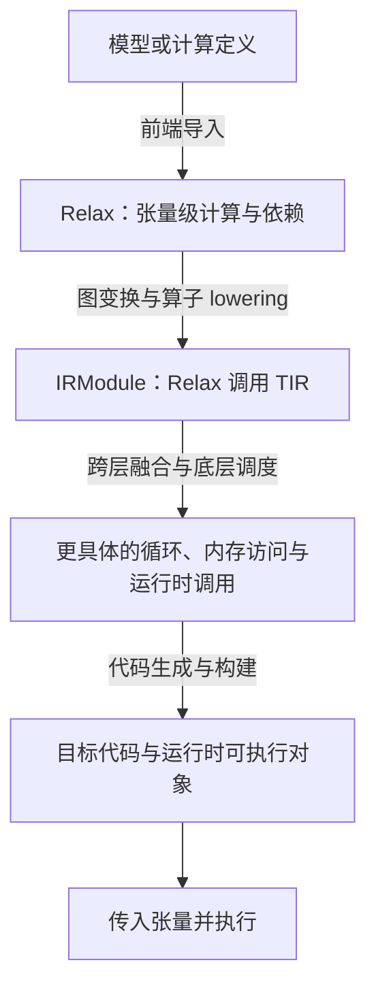

# TVM 入门：Relax、TIR 与图优化

这份笔记从基础概念出发，介绍模型怎样进入编译器、不同层次的 IR 各自表达什么，以及优化必须遵守哪些语义约束。示例为独立教学例子，不依赖某个项目或某台机器。

## 1. 从模型到可执行程序

**张量**是带有形状（shape）和元素类型（dtype）的多维数组。例如 `(2, 3)` 的 `float32` 张量包含六个单精度浮点数。**算子**对张量进行计算，例如加法、卷积、矩阵乘。**计算图**描述这些计算之间的数据依赖：节点产生结果，后续节点使用结果。

模型通常主要说明“算什么”。例如 `y = relu(x + 1)` 指定先加一再取非负值，却没有完整规定循环如何遍历、是否生成临时数组、用什么向量指令。编译器要把这些计算映射到目标硬件。

TVM 是面向张量计算的编译基础设施。可以从下面的角色分工理解它：

| 部分 | 输入与职责 |
| --- | --- |
| 模型格式或框架 | 表达算子、权重、连接关系与输入输出，例如 ONNX |
| 前端 | 将外部模型翻译成 TVM 的表示，并处理算子、形状与类型 |
| 优化与 lowering | 分析计算，变换程序，逐步补充底层实现细节 |
| 目标后端 | 根据 target 生成目标代码；CPU 路径可使用 LLVM |
| 运行时 | 管理执行所需的函数调用、张量、内存和设备 |

导入成功不等于模型已经执行，也不等于所有外部算子都受支持。前端可能已经进行常量求值或规范化，因此导入后的图未必逐节点对应原模型。

## 2. IR 与 TVM 的多层次表示

**IR（Intermediate Representation，中间表示）**是编译器用于分析和转换程序的数据结构。选择不同抽象层次，是为了让不同问题更容易处理：判断一个张量结果是否无用，不需要先展开所有循环；优化缓存访问，则需要看到循环与索引。



文字路径是：模型 → Relax → Relax 与 TIR 共存 → 后端编译与运行。它表达一种常见路径，而不是要求所有程序都必须经过相同的 pass。

| 维度 | Relax | TIR / TensorIR |
| --- | --- | --- |
| 主要观察对象 | 张量计算、函数调用、数据依赖 | 循环、元素计算、归约、内存访问 |
| 常见信息 | 张量 shape/dtype、算子、常量 | Buffer、索引、计算块、循环变换 |
| 适合讨论的问题 | 哪些结果可提前计算、哪些计算无用、如何分组 | 怎样分块、重排、向量化与安排存储 |
| 典型函数 | Relax Function | PrimFunc |

Relax 还可以表达符号形状、函数与控制流，不能只把它理解为固定形状的算子列表。TIR 也不只是把高层算子换成另一种写法：它显式表达更接近实现的计算和访问方式。

`IRModule` 是函数等定义的容器，可以同时包含 Relax 函数与 TIR `PrimFunc`。高层组织调用，底层实现计算，两者能够共同参与变换。这是理解 TVM 多层次优化的关键。[TVM 架构说明](https://tvm.apache.org/docs/arch/)

### 版本与记号

TVMScript 是构造、展示 IR 的 Python 风格语法；其中的代码描述待编译程序，并不等同于逐行执行 NumPy。

本文的 Relax 例子使用 `R` 作为别名。底层术语沿用“TIR”；在 TVM `0.25.0.post1` 的实际 API 中可以看到 `tvm.tirx`、`tvm.s_tir`、`T.sblock`，旧资料则常见 `tvm.tir`、`T.block`。模块名和构建接口需要与所安装版本核对，不能直接混用。旧版 Relay 资料中的图优化思想仍有参考价值，但 Relay 与 Relax 的 API 和流水线并不相同。

## 3. 读懂一段 Relax

下面是一个完整的教学定义，计算输入加上一个常量偏置，同时故意保留无用乘法：

```python
from tvm.script import ir as I, relax as R

@I.ir_module
class Example:
    @R.function
    def main(x: R.Tensor((2, 3), "float32")) -> R.Tensor((2, 3), "float32"):
        with R.dataflow():
            bias = R.add(R.const(2.0, "float32"), R.const(3.0, "float32"))
            unused = R.multiply(x, R.const(7.0, "float32"))
            y = R.add(x, bias)
            R.output(y)
        return y
```

阅读时依次关注：

1. `R.Tensor` 描述输入输出的形状和类型，不是具体数值。
2. `R.const` 表示常量，`R.add`、`R.multiply` 表示张量算子；标量在这里广播到各个元素。
3. 每个变量绑定一个计算结果；沿定义与使用关系，可以确定依赖。
4. `R.dataflow()` 标记供编译器分析的数据流区域，`R.output(y)` 声明区域向外暴露的值。
5. `return y` 返回函数结果；`unused` 没有参与返回结果，也没有需要保留的副作用。

实际含义是 `y = x + 5`。这里同时存在常量折叠与死代码消除的机会。生成 IR 中的 `lv`、`gv` 等名字主要是中间变量标识，理解依赖比记名字重要。

## 4. 从 Relax 到 TIR：lowering 与 call_tir

**Lowering** 是把抽象计算逐步转换为更具体表示的过程。例如把“两个张量相加”变为“调用一个逐元素循环函数”。它可能是编译所必需的步骤，本身不意味着性能提高。

在常见的 Relax 算子 lowering 路径中，`LegalizeOps` 为支持的高层算子生成底层实现，并将调用改写为 `R.call_tir`。生成的 `PrimFunc` 与调用它的 Relax 函数可以留在同一个模块里。[IRModule 教程](https://tvm.apache.org/docs/get_started/tutorials/ir_module.html)

下面是调用片段示意，不是独立可运行模块；假设 `add_one` 已定义：

```python
y = R.call_tir(add_one, (x,), out_sinfo=R.Tensor((2, 3), "float32"))
```

`out_sinfo` 描述输出结构信息，不能把它当作输出数据。Relax 层把调用看成得到一个张量；底层函数可以通过写入输出 buffer 实现计算。

例如矩阵乘 `C = A @ B` 的数学定义为：

```text
C[i, j] = sum_k A[i, k] * B[k, j]
```

对应的循环伪代码如下。它解释计算含义，不代表最优调度：

```python
for i in range(M):
    for j in range(N):
        C[i, j] = 0
        for k in range(K):
            C[i, j] += A[i, k] * B[k, j]
```

`i、j` 决定输出位置，是空间轴；`k` 将多个乘积累积到同一输出，是归约轴。阅读 TIR 时可以对照：

| 记号 | 含义 |
| --- | --- |
| `@T.prim_func` | 定义底层张量函数 |
| `T.Buffer` | 描述存储的形状、类型及访问对象 |
| `T.grid` | 多层循环的紧凑写法 |
| `T.sblock` 或旧版 `T.block` | 描述一个可供分析与调度的计算块 |
| `T.axis.remap("SSR", ...)` | 两个空间轴和一个归约轴 |
| `T.reads` / `T.writes` | 计算块的读写区域 |
| `T.init()` | 归约初始化，在开始累积时执行 |

`T.init()` 出现在计算块内，不表示每次归约迭代都清零。判断程序时，应结合归约语义阅读，而不是简单当作普通 Python 缩进执行。

## 5. Pass 与流水线

Pass 是一次分析或变换。变换通常接收 IR，返回转换后的 IR；多个 pass 按顺序组成 pipeline。

```python
# 概念示意
mod = fold_constants(mod)
mod = eliminate_dead_code(mod)
mod = lower_operators(mod)
```

顺序会影响机会：某次变换可能暴露新的常量表达式，也可能产生新的无用节点。不同后端的默认流水线还可能隐含融合、布局或调度步骤。

因此，实验中判断 pass 作用，应比较**紧邻该 pass 的前后 IR**，并确认实际执行的 pass 列表。只修改 `opt_level`，不一定等价于精确关闭某项优化。一个 pass 没有改变 IR，也可能只是没有符合条件的模式。

## 6. 四种图优化

### 6.1 常量折叠（FoldConstant）

```text
之前：b = 2 + 3；y = x + b
之后：b = 5；    y = x + b
```

第一处加法的输入在编译时已知，可以提前求值；第二处依赖运行时输入，必须保留。

前提是计算所需值已知、运算支持编译期求值，并遵守相关数值语义。卷积权重是常量，不意味着卷积本身可以折叠，因为输入图像通常未知。收益可能是减少运行时计算；代价可能是增加编译开销或常量存储。前端可能已经折叠常量，因此重复执行没有新变化并不奇怪。

### 6.2 死代码消除（DeadCodeElimination，DCE）

```text
之前：unused = x * 7；y = x + 5；返回 y
之后：               y = x + 5；返回 y
```

如果某项纯计算既不影响最终输出，也没有其他可观察行为，就有机会删除。分析依赖时通常从需要保留的输出与行为反向追踪。

不能只看变量是否被返回：它可能被别的有效结果间接使用。也不能只看变量名是否叫 `unused`。带副作用的调用，例如写外部状态，即使返回值没人使用也未必可删除。DCE 可能减少计算和存储，但不存在死代码时不会产生收益。

### 6.3 算子融合（Fusion）

对 `y = relu(x + 1)`，一种未融合实现会先写临时张量，再读取它计算 ReLU；一种融合实现可以在同一循环内完成两步，直接写结果。

典型自动融合路径是：

```text
LegalizeOps → AnnotateTIROpPattern → FuseOps → FuseTIR
```

其中模式标注提供算子计算性质，`FuseOps` 建立带 `Primitive` 标记的 Relax 函数组，`FuseTIR` 再合并组内底层函数。`Primitive` 标记的 Relax 函数与 TIR `PrimFunc` 是不同层次的对象。[TVM 融合说明](https://tvm.apache.org/docs/arch/fusion.html)

融合受数据依赖、计算模式和实现支持约束，并非相邻节点都能融合。它可能减少调用开销与中间读写，也可能增加资源压力。合并函数不代表所有循环和临时 buffer 已经合并或消失，还需检查后续底层实现。最终是否更快要测量。

### 6.4 布局转换（Layout Conversion）

布局描述张量数据的组织和索引方式。图像常见维度顺序：

| 布局 | 维度顺序 |
| --- | --- |
| NCHW | 批大小、通道、高、宽 |
| NHWC | 批大小、高、宽、通道 |

从 NCHW 转为 NHWC，需要维持元素对应关系：

```text
y[n, h, w, c] = x[n, c, h, w]
```

**Reshape 不等于轴交换。** 用二维小例子即可看出：

```text
x = [[0, 1, 2], [3, 4, 5]]
reshape 到 (3, 2)：[[0, 1], [2, 3], [4, 5]]
transpose 后 (3, 2)：[[0, 3], [1, 4], [2, 5]]
```

两者输出 shape 相同，元素位置不同。Reshape 按原元素序列重新划分维度；轴交换改变坐标对应关系。物理布局还可能包含通道分块，不止 NCHW/NHWC 两种。

`ConvertLayout` 可用于指定某些算子的目标布局，并在受支持的图中进行布局转换。选择布局要配合算子实现，并正确处理权重、广播偏置、后继节点与外部输入输出约定。[Relax 变换 API](https://tvm.apache.org/docs/reference/api/python/relax/transform.html#tvm.relax.transform.ConvertLayout)

收益可能来自连续访问、向量化或匹配高效内核；转换也可能带来额外搬运，因此应看整段计算的总成本。布局变换不保证总是独立拷贝，也可能被吸收到索引或算子实现中。

## 7. 语义正确性与浮点精度

图优化必须维持程序约定的行为，包括输出形状、类型、数据关系和必要副作用。浮点计算中，还需要明确允许的误差标准。

### FP16 往返转换不能随意删除

```text
约 1.0001（FP32）→ 1.0（FP16）→ 1.0（FP32）
```

FP16 可表示的值更稀疏，第一次转换发生舍入，第二次转换无法恢复已经丢失的信息。因此 `fp32 → fp16 → fp32` 一般不是恒等变换。可以把转换融合到同一个函数，但必须保留要求的中间舍入语义。

类似地，两个 Reshape 是否可消除，需要检查最终形状、元素顺序和中间结果的其他使用者；不能因为操作名称重复就直接删除。

### 怎样验证优化

先比较 shape、dtype，再按业务约定处理有限值、NaN 与 Inf，最后比较数值。常见指标有：

```text
最大绝对误差 = max(|actual - reference|)
allclose 条件：|actual - reference| <= atol + rtol * |reference|
```

`atol` 在参考值接近零时尤其重要，`rtol` 则随参考值大小变化。容差应依据数据类型、运算特点和应用要求确定，不存在对所有模型通用的阈值。

浮点加法不满足严格结合律，归约顺序变化可能产生小误差。跨实现比较通常需要容差；但容差检查可能掩盖错误删除 Cast 的问题，因此关键舍入行为应使用针对边界的专项用例。数值逐元素相等也不等于所有位模式完全一致，例如正负零。

可以同时使用两类对照：独立参考实现检查整个编译路径，优化前后的同一系统输出检查本次变换。随机输入覆盖一般情况，零值、边界和特殊形状覆盖特定问题。有限测试提供证据，不构成所有输入上的数学证明。

## 8. 调度与 auto-tune

矩阵乘的数学定义固定后，循环仍可有多种组织方式。**Schedule（调度）**描述这些组织方式：分块、重排、向量化、并行化、缓存与计算位置等。

以分块为例，将矩阵分成小块处理，可能提高缓存复用；沿连续维度向量化，可能更好地使用 SIMD 指令。变换必须符合依赖关系、硬件约束与浮点精度要求，不是任意重排都合法。

TE（Tensor Expression）是一种定义张量计算的方式，可以生成 `PrimFunc`；它描述计算，不自动意味着已经得到高效调度。MetaSchedule 则搜索调度候选，通过编译、运行与测量选择记录中的较好实现：

```text
计算定义 → 候选 schedule → 编译与测量 → 记录/评估 → 选择实现
```

有限搜索预算不保证全局最优；代价模型用于帮助搜索，并不能代替最终测量。调优优化的是计算实现，不是在训练模型或更新权重。

| 对比 | 图融合 | 算子调优 |
| --- | --- | --- |
| 关注点 | 哪些计算放在同一组中 | 组内或算子内部怎样执行 |
| 观察证据 | 调用关系与融合函数变化 | 循环、索引、存储与 schedule 变化 |
| 联系 | 为后续底层优化提供更大的计算范围 | 可以优化融合后产生的底层计算 |

## 9. 怎样判断性能收益

先验证正确性，再比较相同硬件、形状、类型和线程设置下的性能。明确计时是否包含编译、调优、数据传输、内存分配和同步；GPU 异步执行还需确保计时覆盖实际完成的工作。

预热可以减少首次调用影响，重复测量并报告中位数及分位数有助于观察波动。加速比通常计算为“基线耗时 / 优化耗时”，但必须说明基线是什么；相对朴素循环的提速不能直接证明优于成熟算子库。

判断一次优化可以按三步进行：

1. **结构证据**：相邻 IR 中究竟改变了什么？
2. **正确性证据**：对哪些输入、按什么标准验证过？
3. **性能证据**：在同等测量条件下，收益是否超过噪声？

理解这三点，才能把“运行了某个 pass”与“发生了有效且正确的优化”区分开。
